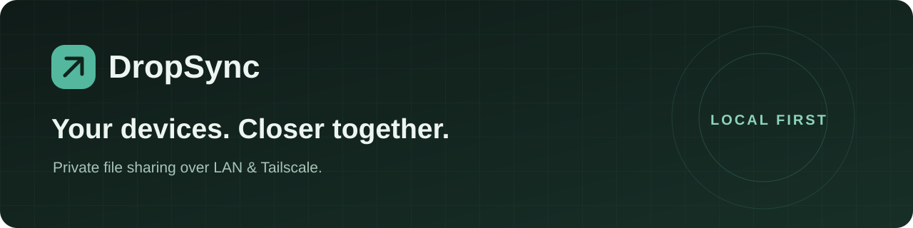
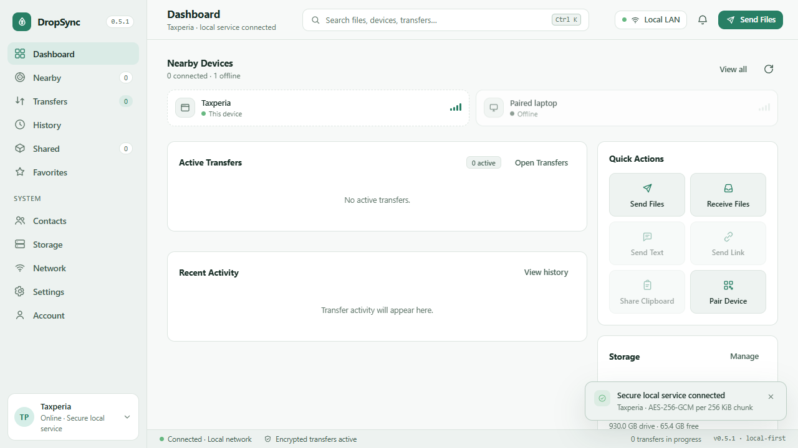

<p align="center">
  
</p>

<p align="center">
  <strong>Private file sharing between your paired devices.</strong><br>
  Send files over your LAN or existing Tailscale network. No account required for personal sharing.
</p>

<p align="center">
  <a href="https://github.com/Taxperia/dropsync/actions/workflows/ci.yml"></a>
  <a href="https://github.com/Taxperia/dropsync/releases"></a>
  <a href="LICENSE"></a>
  
</p>

<p align="center">
  <a href="#downloads">Downloads</a> · <a href="#get-started">Get started</a> · <a href="#run-from-source">Run from source</a> · <a href="SECURITY.md">Security</a> · <a href="CONTRIBUTING.md">Contribute</a>
</p>

> **Version status:** this repository contains **0.7.0 development source**. The downloadable **0.5.1 legacy previews** are older builds: they do not include the newer protocol and security changes. There is no stable release yet. Native builds and real-device validation of 0.7.0 remain pending; use synthetic files when evaluating it.

## Why DropSync?

- **A direct route.** Transfer between explicitly paired devices over a private network, without a DropSync cloud file relay.
- **You choose who receives.** One-time pairing codes and device fingerprints establish trust. Receiving asks for approval by default.
- **Encrypted transfers.** The current source uses Ed25519 identities, X25519 key agreement and AES-256-GCM file frames with authenticated completion receipts.
- **A familiar workspace.** Nearby devices, transfer progress, history, saved-file locations and light/dark themes in one interface.
- **Your network, your choice.** Discover devices on LAN, or add a private Tailscale IPv4 address/full MagicDNS name.

<p align="center">
  
  <br><sub>Actual 0.5.1 desktop preview. Newer source features are listed separately below.</sub>
</p>

## Downloads

| Platform | Download | Status |
| --- | --- | --- |
| Windows x64 | [Windows installer (.exe)](https://github.com/Taxperia/dropsync/releases/download/legacy-v0.5.1/DropSync-Setup-0.5.1.exe) | Legacy 0.5.1 preview; not a current production build |
| Android 8+ | [Android APK](https://github.com/Taxperia/dropsync/releases/download/legacy-v0.5.1/DropSync-Android-0.5.1-debug.apk) | Legacy 0.5.1, debug-signed; Android sends to paired computers |
| macOS / Linux | Build from source | Package targets exist; native validation is pending |

[Release notes and SHA-256 checksums](https://github.com/Taxperia/dropsync/releases/tag/legacy-v0.5.1) explain the exact limits of the archived packages. These binaries predate the current source; the release tag is an archive marker, not their original build revision. Do not mix 0.5.x and 0.7.x peers: the newer transfer protocol has no insecure downgrade.

EXE/APK files are distributed as release assets. They are not committed to the source repository. The Android APK uses the original development certificate; a production-signed release and store distribution are not available yet.

## Get started

1. Run compatible versions of DropSync on both devices, on the same LAN or an existing Tailscale network.
2. Find the other device, compare its fingerprint through a trusted channel, and enter its six-digit pairing code.
3. Choose files, select the paired device, and send. The receiver accepts or declines the request.
4. Find the result in **Shared** or the receiving folder. Opening a received file is always a separate user action.

With the 0.5.1 preview, Android sends to a paired computer; it cannot receive files. Keep the Android app open until sending finishes. Android's system Share menu can supply files or text to DropSync.

### What's in the 0.7.0 source?

These features are implemented in the development source and still need runtime/platform acceptance:

| Area | Current source |
| --- | --- |
| PC ↔ Android | Bidirectional transfer, receiver approval and Android system folder selection (SAF) |
| Background sharing | Electron tray, Android foreground service, notifications and cancellation |
| Text and clipboard | Explicit Send Text / Share Clipboard actions; no clipboard history or remote clipboard overwrite |
| Reliability | Fresh-key retries, duplicate-completion protection, transfer history and speed limits |
| Local protection | OS/passphrase-protected identity and local records; Android Keystore integration |
| Optional analysis | Opt-in VirusTotal hash lookup; uploading unknown file contents requires a separate setting |
| Managed deployments | Device policies and optional company OIDC sign-in; separate commercial permission required |

Retries restart a file from the beginning. Byte-offset resume and automatic continuation after process death are not implemented. Android TV support, macOS/Linux packaging and upgrades require real-device testing. iOS is outside the current scope.

## Run from source

Use **Node.js 22.12+** and Git. Personal file sharing needs no account provider or external service configuration.

```bash
git clone https://github.com/Taxperia/dropsync.git
cd dropsync
npm ci
npm start
```

Open **http://127.0.0.1:47821/**. For the desktop interface, run `npm run desktop` instead of `npm start`. Review code and dependencies before running development software.

Windows uses the current user's DPAPI vault. macOS/Linux desktop uses the OS secret store; CLI mode requires a strong `DROPSYNC_VAULT_PASSPHRASE` of at least 12 characters, supplied through your local environment. Keep that value out of command history and source control. Quit older DropSync services before upgrading, and do not run two instances against the same data directory.

| Task | Command |
| --- | --- |
| Check JavaScript syntax | `npm run check` |
| Run isolated Node fixtures on a Docker-capable Linux host | `docker pull node:22-bookworm-slim`, then `bash scripts/test-isolated.sh` |
| Build Windows installer | `npm run dist:win` |
| Build macOS / Linux packages on their native OS | `npm run dist:mac` / `npm run dist:linux` |
| Build Android release | From `android/`: `./gradlew assembleRelease` with the existing release signing key configured |

See [CONTRIBUTING.md](CONTRIBUTING.md) for testing, signing requirements and release validation. Optional account-service settings are documented in `auth-server/.env.example`; sign-in never replaces device pairing.

## Privacy and limits

The current protocol encrypts file contents, names and hashes, but network addresses, device discovery names, public keys, transfer sizes and timing can remain visible. It does not claim full forward secrecy. Saved files and outgoing staging copies are ordinary filesystem files; local-record encryption does not encrypt your download folder.

The browser/API listens on loopback. Use private LAN/Tailscale peer connections; do not port-forward DropSync to the public internet. VirusTotal is off by default, and enabling hash lookup shares a content fingerprint with that provider. No antivirus result guarantees a file is safe.

The updater stays disabled until a publisher signing key is configured. Current source has not received a comprehensive independent security audit. Read the [security policy and threat model](SECURITY.md), and [report vulnerabilities privately](https://github.com/Taxperia/dropsync/security/advisories/new).

## Help shape the next release

Useful contributions include reproducible transfer bugs, accessibility feedback, Android OEM/SAF testing and native macOS/Linux validation. [Report a bug](https://github.com/Taxperia/dropsync/issues/new?template=bug_report.yml) or [suggest an improvement](https://github.com/Taxperia/dropsync/issues/new?template=feature_request.yml). Please keep private filenames, logs and credentials out of public reports.

If DropSync fits your workflow, a star helps others find it. Follow [Releases](https://github.com/Taxperia/dropsync/releases) for new packages.

## License

Copyright © 2026 **Miyotu**. [DropSync Noncommercial License 1.0](LICENSE) permits noncommercial use, modification and redistribution under its terms. Commercial/business use requires separate written permission. This is source-available software under a noncommercial license, not an OSI-approved open-source license. Third-party licenses and earlier valid grants remain intact.
